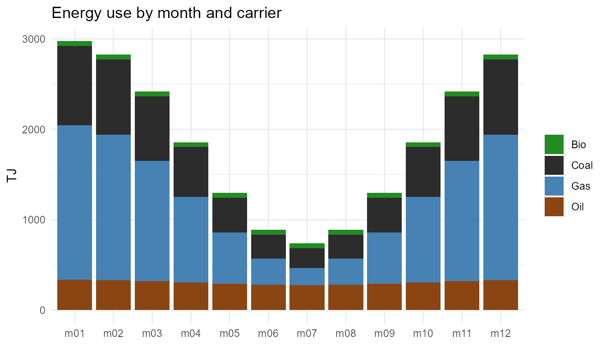
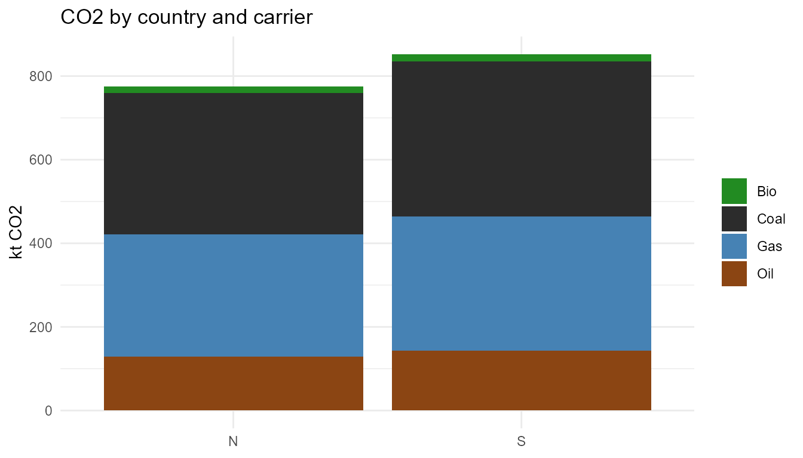
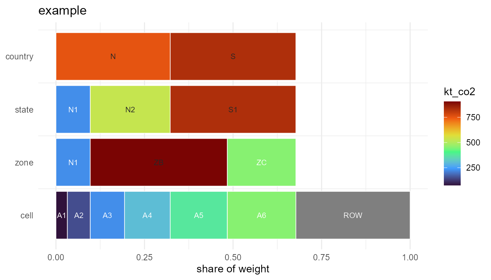
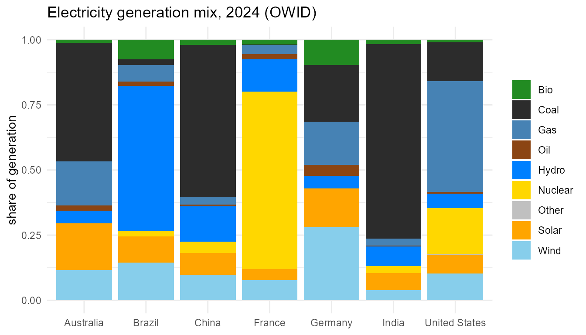

# Fuels, regions and months

## Three scales, one vocabulary

A fuel-use table has three dimensions a model cares about: *which fuel*,
*where*, *when*. Each is a nested scale – a fuel taxonomy built from
energypal’s palette, and the classes of two sibling packages built on
the same core – and each attaches to a table under its own name:

``` r

# fuels: group > carrier > fuel, from energypal's `carriers` palette
ct <- energypal::energypal_table("carriers", include_groups = TRUE)
l2 <- ct[ct$level == 2, ]
l3 <- ct[ct$level == 3, ]
own <- setdiff(l2$name, l3$parent)     # a carrier without subtypes is a fuel
leaf <- rbind(data.frame(carrier = l3$parent, fuel = l3$name),
              data.frame(carrier = own, fuel = own))
leaf$group <- l2$parent[match(leaf$carrier, l2$name)]
spelt <- which(!is.na(ct$aliases) & nzchar(ct$aliases))
al <- unique(do.call(rbind, lapply(spelt, function(i) {
  data.frame(frame = c("group", "carrier", "fuel")[ct$level[i]],
             member = ct$name[i],
             alias = trimws(strsplit(ct$aliases[i], ";", fixed = TRUE)[[1]]),
             source = "energypal")
})))
es <- scale_from_leaftable(
  leaf[c("group", "carrier", "fuel")],
  frames = c("group", "carrier", "fuel"), leaf = "fuel", name = "carriers",
  aliases = al[nzchar(al$alias), ]
)
gs  <- geoscale_example()             # regions: country > state > zone > cell
cal <- calendar("m12")                 # time:    MONTH

scale_members(es, "carrier")
#>  [1] "FossilCoal"          "FossilOil"           "FossilGas"          
#>  [4] "Bioenergy"           "Hydro"               "Wind"               
#>  [7] "Solar"               "Geothermal"          "OtherRenewables"    
#> [10] "Nuclear"             "Hydrogen"            "HydrogenDerivatives"
#> [13] "SyntheticFuels"      "Storage"             "Electricity"        
#> [16] "Heat"                "Other"
geoscale_regions(gs, "country")
#> [1] "N" "S"
calendar_timeslices(cal)
#>  [1] "m01" "m02" "m03" "m04" "m05" "m06" "m07" "m08" "m09" "m10" "m11" "m12"
```

## A fuel-use table

Twelve months of fuel use in six regions for five fuels, in kilotonnes.
The numbers are made up but shaped: coal and gas follow a heating
season, the size of each region scales its use.

``` r

use <- expand.grid(
  cell = geoscale_regions(gs)[geoscale_regions(gs) != "ROW"],
  timeslice = calendar_timeslices(cal),
  fuel = c("Anthracite", "Lignite", "DistillateFuelOil", "NaturalGas",
           "Biodiesel"),
  stringsAsFactors = FALSE
)
base <- c(Anthracite = 2, Lignite = 6, DistillateFuelOil = 1.5,
          NaturalGas = 4, Biodiesel = 0.3)
seasonal <- c(Anthracite = 0.6, Lignite = 0.6, DistillateFuelOil = 0.1,
              NaturalGas = 0.8, Biodiesel = 0)
size <- geoscale_leaftable(gs) |>
  transmute(cell, size = km2 / mean(km2))
use <- use |>
  left_join(size, by = "cell") |>
  mutate(
    month = match(timeslice, calendar_timeslices(cal)),
    kt = base[fuel] * size *
      (1 + seasonal[fuel] * cos(2 * pi * (month - 1) / 12))
  ) |>
  select(cell, timeslice, fuel, kt)
head(use)
#>   cell timeslice       fuel        kt
#> 1   A1       m01 Anthracite 0.7225806
#> 2   A2       m01 Anthracite 1.4451613
#> 3   A3       m01 Anthracite 2.1677419
#> 4   A4       m01 Anthracite 2.8903226
#> 5   A5       m01 Anthracite 3.6129032
#> 6   A6       m01 Anthracite 4.3354839
```

## Attach all three

Each join adds columns prefixed by the scale’s name, so the three never
collide and a reader can see which scale a column came from:

``` r

labelled <- use |>
  join_scale(es, frame = "fuel", attach = TRUE) |>
  join_geoscale(gs = gs, geoframe = "cell", geoframes = TRUE) |>
  join_calendar(calendar = cal, meta = TRUE)
names(labelled)
#>  [1] "cell"             "timeslice"        "fuel"             "kt"              
#>  [5] "carriers.group"   "carriers.carrier" "carriers"         "example.country" 
#>  [9] "example.state"    "example.zone"     "example"          "m12"             
#> [13] "m12.share"        "m12.weight"
head(labelled, 3)
#>   cell timeslice       fuel        kt carriers.group carriers.carrier
#> 1   A1       m01 Anthracite 0.7225806    FossilFuels       FossilCoal
#> 2   A2       m01 Anthracite 1.4451613    FossilFuels       FossilCoal
#> 3   A3       m01 Anthracite 2.1677419    FossilFuels       FossilCoal
#>     carriers example.country example.state example.zone example m12  m12.share
#> 1 Anthracite               N            N1           N1      A1 m01 0.08493151
#> 2 Anthracite               N            N1           N1      A2 m01 0.08493151
#> 3 Anthracite               N            N2           ZB      A3 m01 0.08493151
#>   m12.weight
#> 1        744
#> 2        744
#> 3        744
```

`carriers.carrier` and `carriers.group` come from the fuel scale,
`example.country` and friends from the GeoScale, `m12.share` and
`m12.weight` (hours) from the Calendar.

## Mass to energy to CO2

The fuel scale ships without values, so a net calorific value (GJ/t) and
a CO2 factor (kg/TJ) are attached for these five fuels first; the
numbers are round and illustrative. Each conversion is then one call,
keyed by fuel, and the factor applied is reported alongside the result:

``` r

fuels <- unique(use$fuel)
es <- attach_attributes_scale(
  es,
  data.frame(
    frame = "fuel", member = rep(fuels, 2),
    attribute = rep(c("lhv", "ef_co2"), each = length(fuels)),
    kind = rep(c("property", "factor"), each = length(fuels)),
    value = unname(c(
      c(Anthracite = 28, Lignite = 10, DistillateFuelOil = 43,
        NaturalGas = 50, Biodiesel = 37)[fuels],
      c(Anthracite = 95000, Lignite = 100000, DistillateFuelOil = 74000,
        NaturalGas = 55000, Biodiesel = 70000)[fuels]
    )),
    unit_of_measure = rep(c("GJ/t", "kg/TJ"), each = length(fuels))
  ),
  source = "example"
)
energy <- use |>
  mutate(t = kt * 1e3) |>
  select(cell, timeslice, fuel, t) |>
  convert_scale(es, "lhv", from_unit = "t", to_unit = "GJ") |>
  transmute(cell, timeslice, fuel, tj = t / 1e3)

co2 <- energy |>
  convert_scale(es, "ef_co2", from_unit = "TJ", to_unit = "kg") |>
  rename(kg_co2 = tj) |>                 # the converted column: kg CO2
  transmute(cell, timeslice, fuel, tj = energy$tj, kt_co2 = kg_co2 / 1e6)
head(co2, 3)
#>   cell timeslice       fuel       tj   kt_co2
#> 1   A1       m01 Anthracite 20.23226 1.922065
#> 2   A2       m01 Anthracite 40.46452 3.844129
#> 3   A3       m01 Anthracite 60.69677 5.766194
```

## Aggregate along any dimension

Every scale aggregates with the same verb and the same rules. Columns
the scale does not know (the other dimensions’ keys) are carried through
as identifiers. One registration covers all three dimensions:

``` r

register_scale_rule("tj", "sum")
register_scale_rule("kt_co2", "sum")
```

**By carrier and month** – the fuel dimension collapses, region and
month stay:

``` r

by_carrier <- co2 |>
  recast_scale(es, source = "fuel", target = "carrier",
               missing_sources = "ignore") |>
  filter(!is.na(tj))
#> Warning: 66 source member(s) present in the scale but missing from the data
#> (e.g. Ammonia, AssociatedGas, Battery, ... (66 total)); produced NAs
head(by_carrier, 3)
#>      carrier cell timeslice       tj   kt_co2
#> 1 FossilCoal   A1       m01 41.90968 4.089806
#> 2  FossilOil   A1       m01 16.02097 1.185552
#> 3  FossilGas   A1       m01 81.29032 4.470968
sum(by_carrier$tj) - sum(co2$tj)
#> [1] 0
```

The table reports five of the 71 fuels. With
`missing_sources = "ignore"` the others count as unused rather than
unknown, and the total is conserved – the difference above is zero.

**By country** – the pipeline verb
[`recast()`](https://optimal2050.github.io/nestedscales/r/reference/recast.md)
dispatches on whichever scale it is handed, so the two aggregations
chain:

``` r

by_country <- co2 |>
  recast(es, target = "carrier", missing_sources = "ignore") |>
  filter(!is.na(tj)) |>
  recast(gs, target = "country")
#> Warning: 66 source member(s) present in the scale but missing from the data
#> (e.g. Ammonia, AssociatedGas, Battery, ... (66 total)); produced NAs
by_country |>
  group_by(country) |>
  summarise(tj = sum(tj), kt_co2 = sum(kt_co2))
#> # A tibble: 2 × 3
#>   country     tj kt_co2
#>   <chr>    <dbl>  <dbl>
#> 1 N       10611.   755.
#> 2 S       11672.   831.
```

**By quarter** – a calendar recast needs the year, to place the months
on real dates:

``` r

by_quarter <- by_carrier |>
  select(carrier, cell, timeslice, tj, kt_co2) |>
  recast_calendar(source = cal, target = calendar("q4"), year = 2024)
head(by_quarter, 4)
#>   timeslice    carrier cell        tj    kt_co2
#> 1        Q1 FossilCoal   A1 115.76541 11.297107
#> 2        Q2 FossilCoal   A1  57.11201  5.573345
#> 3        Q3 FossilCoal   A1  41.39588  4.039667
#> 4        Q4 FossilCoal   A1 100.04928  9.763429
sum(by_quarter$tj) - sum(by_carrier$tj)
#> [1] 0
```

## Draw it with energypal’s colours

energypal’s `carriers` palette is the same taxonomy, so the carrier ids
map straight onto its colours with no relabelling:

``` r

by_carrier |>
  group_by(timeslice, carrier) |>
  summarise(tj = sum(tj), .groups = "drop") |>
  ggplot(aes(x = timeslice, y = tj, fill = carrier)) +
  geom_col() +
  energypal::scale_fill_energy(palette = "carriers",
                               label_style = "short") +
  labs(x = NULL, y = "TJ", fill = NULL,
       title = "Energy use by month and carrier") +
  theme_minimal()
```



``` r

by_country |>
  group_by(country, carrier) |>
  summarise(kt_co2 = sum(kt_co2), .groups = "drop") |>
  ggplot(aes(x = country, y = kt_co2, fill = carrier)) +
  geom_col() +
  energypal::scale_fill_energy(palette = "carriers",
                               label_style = "short") +
  labs(x = NULL, y = "kt CO2", fill = NULL,
       title = "CO2 by country and carrier") +
  theme_minimal()
```



The GeoScale draws its own hierarchy with data attached – CO2 summed to
every geoframe at once:

``` r

co2_by_leaf <- co2 |>
  group_by(cell) |>
  summarise(kt_co2 = sum(kt_co2), .groups = "drop")
gg_geoscale(gs, data = co2_by_leaf, z = "kt_co2", rule = "sum")
```



## Matching labels from a statistical source

Real sources spell carriers their own way. energypal ships a slice of
Our World in Data’s electricity mix; its `source` labels resolve against
the fuel scale’s names and aliases exactly, with `frame = "carrier"`
settling the names that exist at two frames (`Nuclear`, `Other`):

``` r

mix <- energypal::owid_energy_mix
matched <- scale_match(es, unique(mix$source), frame = "carrier")
matched
#>         label   frame     member method candidates
#> 1   Bioenergy carrier  Bioenergy  exact       <NA>
#> 2        Coal carrier FossilCoal  alias       <NA>
#> 3       Hydro carrier      Hydro  exact       <NA>
#> 4 Natural Gas carrier  FossilGas  alias       <NA>
#> 5     Nuclear carrier    Nuclear  exact       <NA>
#> 6         Oil carrier  FossilOil  alias       <NA>
#> 7       Solar carrier      Solar  exact       <NA>
#> 8        Wind carrier       Wind  exact       <NA>
#> 9       Other carrier      Other  exact       <NA>
```

Join the resolved id on and the palette applies:

``` r

mix |>
  filter(year == 2024) |>
  left_join(matched |> select(source = label, carrier = member),
            by = "source") |>
  ggplot(aes(x = country, y = generation_twh, fill = carrier)) +
  geom_col(position = "fill") +
  energypal::scale_fill_energy(palette = "carriers",
                               label_style = "short") +
  labs(x = NULL, y = "share of generation", fill = NULL,
       title = "Electricity generation mix, 2024 (OWID)") +
  theme_minimal()
```



## What each package did

|  | package | contributed |
|----|----|----|
| fuels | nestedscales | the scale, the attached values, conversion, label matching |
| regions | geoscales | the region hierarchy, aggregation to countries, the icicle |
| time | timescales | month shares and hours, aggregation to quarters |
| taxonomy and colours | energypal | the fuel names and hierarchy, and one palette for every figure, by carrier id |

The core is what lets one table carry all three and lets
[`recast()`](https://optimal2050.github.io/nestedscales/r/reference/recast.md)
chain across them.
